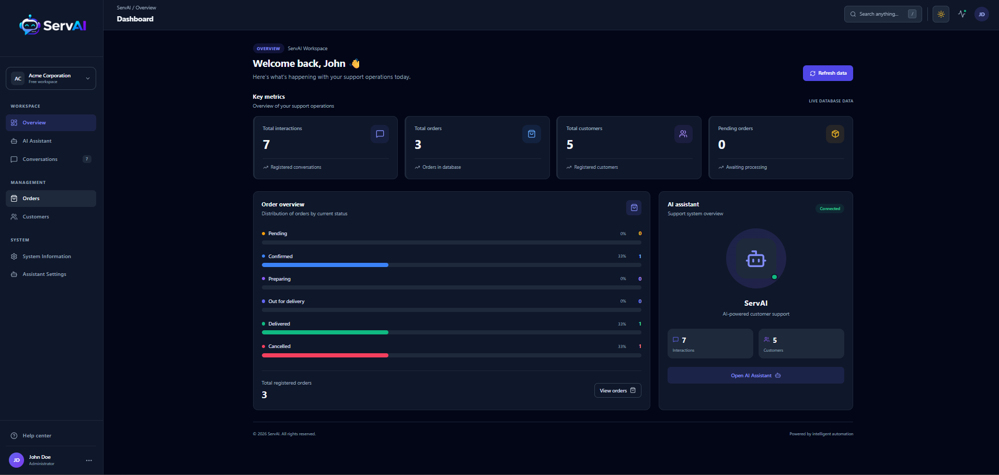
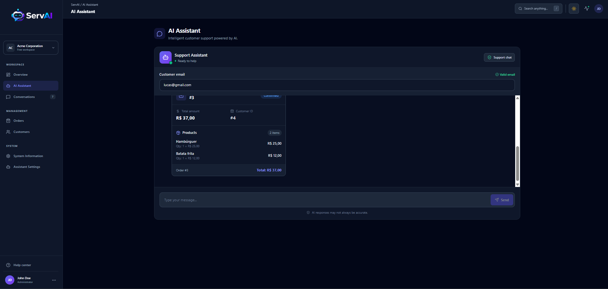
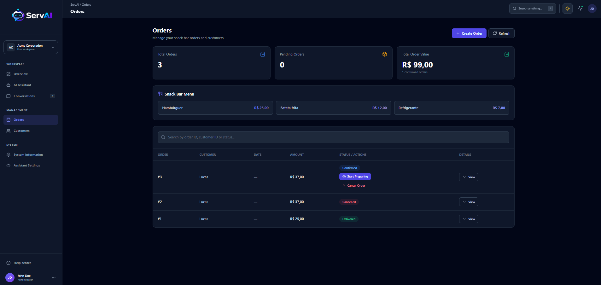
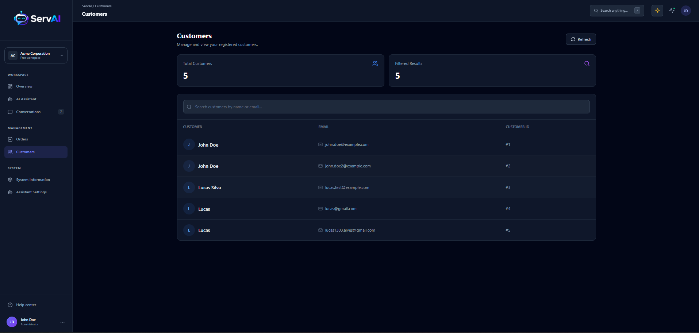
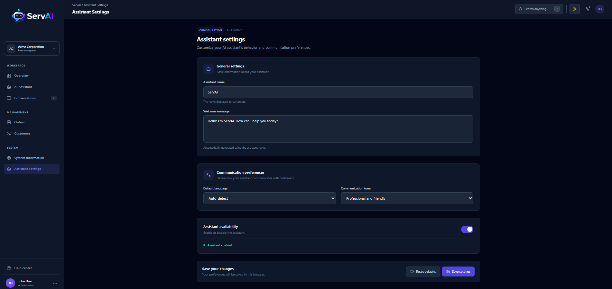

# ServAI

<div align="center">
  
</div>

<p align="center">
  <strong>Your support. Simplified.</strong>
</p>

<p align="center">
  An AI-powered customer support platform that streamlines customer service operations, centralizes order management, and enhances customer interactions using Google Gemini.
</p>

<p align="center">
  
  
  
  
  
  
</p>

---

## Overview

ServAI is an AI-powered customer support platform designed to make customer service operations more efficient and intuitive.

The platform combines conversational artificial intelligence with customer and order management capabilities, allowing users to interact with business data through a modern web interface.

Powered by Google Gemini Function Calling, FastAPI, and SQLAlchemy, ServAI connects natural language interactions with predefined backend operations.

Users can communicate with the AI assistant to retrieve order information, identify customers, check order details, and perform supported business operations without manually navigating through multiple management screens.

The application also provides dedicated interfaces for managing customers, orders, and order items, alongside a dashboard for monitoring customer support operations.

## Key Features

| Feature | Description |
|---|---|
| AI-Powered Assistant | Provides intelligent customer support using Google Gemini. |
| Function Calling | Connects AI interactions with predefined backend business operations. |
| Order Management | Creates, retrieves, updates, and manages customer orders. |
| Customer Management | Centralizes customer information and records. |
| Order Items Management | Manages products and items associated with customer orders. |
| Order Status Tracking | Tracks orders throughout their lifecycle. |
| Order Cancellation | Allows eligible orders to be cancelled through the AI assistant. |
| Automatic Order Calculation | Recalculates order totals when items are added, modified, or removed. |
| Customer Identification | Identifies and reuses customers through their email addresses. |
| Dashboard | Provides an overview of customer support operations and statistics. |
| Conversations | Provides an interface for customer support conversations. |
| Assistant Settings | Provides configuration options for the AI assistant. |
| Automated Testing | Includes automated tests for backend services and assistant operations. |

## Project Screenshots

### Dashboard



### AI Assistant



### Orders



### Customers



### Assistant Settings



### AI Function Calling Workflow

ServAI uses Google Gemini Function Calling to connect natural language requests with application operations.

1. **User Request:** The user submits a natural language request through the AI assistant.
2. **Request Processing:** FastAPI receives the message and prepares the conversation context.
3. **Function Selection:** Google Gemini determines whether one of the predefined functions is required.
4. **Function Execution:** The backend executes the selected business operation.
5. **Data Retrieval:** The application retrieves or modifies information through its service and repository layers.
6. **Function Response:** The execution result is returned to Google Gemini.
7. **Answer Generation:** Gemini generates a natural language response using the operation result.
8. **User Response:** ServAI returns the final response to the frontend.

### Available AI Functions

| Function | Description |
|---|---|
| `get_order_status` | Retrieves the current status of a customer order. |
| `get_customer_orders` | Retrieves orders associated with a customer. |
| `get_order_items` | Retrieves the items associated with an order. |
| `cancel_order` | Cancels an order when its current status allows cancellation. |

### Order Lifecycle

Orders follow a predefined status lifecycle:

| Status | Description |
|---|---|
| `pending` | Order created and awaiting confirmation. |
| `confirmed` | Order confirmed and accepted. |
| `preparing` | Order is being prepared. |
| `out_for_delivery` | Order is on its way to the customer. |
| `delivered` | Order successfully delivered. |
| `cancelled` | Order cancelled when cancellation rules allow it. |

### Business Rules

- Customers are identified and reused through their email addresses.
- Order totals are automatically recalculated whenever order items are added, modified, or removed.
- Orders can only be cancelled while their status is `pending` or `confirmed`.
- When the last item of an order is deleted, the associated order is automatically removed.
- Order operations are handled through dedicated service and repository layers.

## Technology Stack

### Core Languages

- **Python** — Main programming language used for backend development, application logic, and business operations.
- **TypeScript** — Frontend programming language used for type-safe application development.
- **SQL** — Relational database querying and data management.

### Frameworks and Libraries

| Technology | Role |
|---|---|
| FastAPI | Backend API framework |
| SQLAlchemy | Database ORM and data management |
| Pydantic | Data validation and schema management |
| SQLite | Relational database storage |
| Google Gen AI SDK | Google Gemini integration |
| React | Frontend user interface |
| Vite | Frontend development and build tooling |
| Tailwind CSS | Interface styling |
| Lucide React | Interface icons |
| Recharts | Data visualization and charts |
| Pytest | Automated backend testing |
| Python-dotenv | Environment variable management |

### AI Models

| Model | Purpose |
|---|---|
| Gemini 3.5 Flash-Lite | Natural language understanding, response generation, and function calling |

### Interface Styling

- **Tailwind CSS** — Utility-first styling for the frontend interface.
- **CSS** — Additional visual refinements and custom interface styling.

## Project Structure

```text
ServAI/
├── app/
│   ├── api/
│   │   └── routes/
│   │       ├── assistant.py
│   │       ├── customers.py
│   │       ├── dashboard.py
│   │       ├── health.py
│   │       ├── orders.py
│   │       └── order_items.py
│   ├── core/
│   ├── db/
│   ├── models/
│   ├── repositories/
│   ├── schemas/
│   ├── services/
│   │   ├── assistant_service.py
│   │   ├── assistant_tools.py
│   │   ├── customer_service.py
│   │   ├── dashboard_service.py
│   │   ├── llm_service.py
│   │   ├── order_item_service.py
│   │   └── order_service.py
│   ├── main.py
│   └── __init__.py
├── frontend/
│   ├── public/
│   └── src/
│       ├── assets/
│       ├── components/
│       ├── pages/
│       │   ├── Assistant.tsx
│       │   ├── AssistantSettings.tsx
│       │   ├── Conversations.tsx
│       │   ├── Customers.tsx
│       │   └── Orders.tsx
│       ├── services/
│       ├── App.css
│       ├── App.tsx
│       ├── index.css
│       └── main.tsx
├── assets/
│   ├── screenshots/
│   │   ├── dashboard.png
│   │   ├── ai-assistant.png
│   │   ├── orders.png
│   │   ├── customers.png
│   │   └── assistant-settings.png
│   └── servai-banner.png
├── tests/
│   ├── conftest.py
│   ├── test_assistant_service.py
│   ├── test_assistant_tools.py
│   ├── test_customer_service.py
│   ├── test_order_item_service.py
│   └── test_order_service.py
├── .env.example
├── .gitignore
├── clear_orders.py
├── requirements.txt
└── README.md

```
---

## 📊 Evaluation & Testing

To ensure reliability and correctness, I implemented automated tests and validated the system across real-world usage scenarios.

### Test Coverage
- ✅ **Backend Services:** Unit tests for customer, order, and order item services
- ✅ **Assistant Logic:** Tests for function calling accuracy and tool selection logic
- ✅ **Business Rules:** Validation of order lifecycle, cancellation constraints, and total calculation

### Function Calling Performance
- ✅ **Correct function selection:** ~92% across standard and partial user requests
- ✅ **Proper rejection:** Correctly identifies requests outside available operations
- ✅ **Parameter accuracy:** Customer emails, order IDs, and status values passed correctly to backend

### Test Examples

| User Request | Expected Behavior | Result |
|---|---|---|
| What's the status of order #123? | Calls `get_order_status` with correct ID | ✅ Success |
| Cancel order #456 that was just delivered | Explains delivered orders cannot be cancelled | ✅ Correct rejection |
| Show my orders for john@email.com | Retrieves order list for that customer | ✅ Success |
| Can I change the delivery address? | Responds that feature isn't available yet | ✅ Correct handling |

### Known Limitations & Future Work
- ⚠️ No authentication system implemented — currently open access
- ⚠️ Limited to English-language interactions
- 🔧 **Next steps:** Add user authentication, expand function coverage, implement conversation history persistence


---

**ServAI**

Your support. Simplified.

Developed by [Lucas Alves Grinsencko](https://github.com/LucasGrinsencko1)
