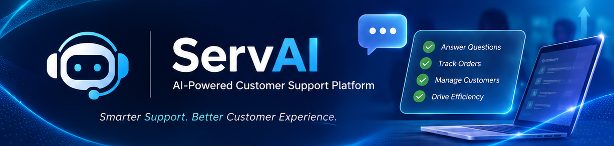

# ServAI
### AI-Powered Customer Support Platform

<div align="center">
  
</div>

An intelligent customer support platform designed to streamline customer service operations, centralize order management, and enhance customer interactions through AI-powered assistance.

ServAI combines a modern web interface, a structured backend architecture, and Google's Gemini AI to deliver an integrated customer support experience.

---

## Overview

ServAI is a full-stack customer support solution designed to demonstrate how artificial intelligence can be integrated into business-oriented applications.

The platform enables customer service teams to manage customers, track orders, monitor operational metrics, and interact with an AI assistant capable of understanding requests and executing predefined business operations through function calling.

The application was designed with maintainability, modularity, and a clear separation of responsibilities in mind.

## Key Features

### AI-Powered Customer Assistant
- Conversational interface powered by Google Gemini.
- Function calling for executing predefined business operations.
- Customer order inquiries.
- Order status tracking.
- Order cancellation requests based on business rules.
- Conversation history management.

### Customer Management
- Customer registration and management.
- Customer information retrieval.
- Email-based customer identification.
- Integration with order management workflows.

### Order Management
- Order creation and administration.
- Order item management.
- Automatic order total calculation.
- Order status tracking.
- Business-rule validation for status transitions.
- Order cancellation management.

### Dashboard & Monitoring
- Centralized operational dashboard.
- Customer and order metrics.
- Order distribution by status.
- Conversation overview.

### User Interface
- Modern React-based application.
- Responsive dashboard layout.
- Dedicated application modules.
- Interactive data management interfaces.
- Consistent visual design.

## Technology Stack

| Layer | Technologies |
|---|---|
| Frontend | React, TypeScript, Vite |
| Styling | Tailwind CSS, CSS |
| Backend | Python, FastAPI |
| Database | SQLite |
| ORM | SQLAlchemy |
| AI Integration | Google Gemini API |
| Testing | Pytest |
| Version Control | Git, GitHub |

## System Architecture

ServAI follows a modular full-stack architecture, separating the presentation layer, API layer, business logic, data access, and database responsibilities.

```text
                 SERVAI PLATFORM
                       |
          +------------+------------+
          |                         |
      FRONTEND                   BACKEND
          |                         |
   React + TypeScript            FastAPI
          |                         |
          |                 +-------+-------+
          |                 |       |       |
          |              Routes  Services  AI Layer
          |                 |       |       |
          |                 +-------+-------+
          |                         |
          |                    Repositories
          |                         |
          |                     SQLAlchemy
          |                         |
          |                       SQLite
          |
          +------ REST API --------+
                                    |
                              Google Gemini
```

### Backend Structure

The backend is organized into dedicated modules:

- **API Routes:** HTTP endpoints and request handling.
- **Services:** Business logic and application rules.
- **Repositories:** Database access and persistence operations.
- **Models:** Database entities and relationships.
- **Schemas:** Request and response validation.
- **Core:** Application configuration.
- **Database:** Connection management and initialization.

This structure promotes separation of concerns and simplifies future maintenance and expansion.

## AI Integration

The AI assistant uses Google's Gemini API to interpret natural-language requests and interact with application functionality.

Through function calling, the assistant can invoke predefined operations instead of relying exclusively on generated text.

Supported operations include:

- Retrieving order information.
- Listing customer orders.
- Retrieving order items.
- Processing eligible order cancellation requests.

This approach connects conversational AI capabilities with structured application business logic.

## Business Rules

The application implements explicit business rules for order lifecycle management.

Supported order status flow:

```text
Pending
   |
   v
Confirmed
   |
   v
Preparing
   |
   v
Out for Delivery
   |
   v
Delivered
```

Orders can also be cancelled when their current status allows it.

Order totals are recalculated automatically when order items are modified.

## Project Structure

```text
servai-ai-customer-support/
|
+-- app/
|   +-- api/
|   |   +-- routes/
|   +-- core/
|   +-- db/
|   +-- models/
|   +-- repositories/
|   +-- schemas/
|   +-- services/
|
+-- frontend/
|   +-- public/
|   +-- src/
|       +-- pages/
|       +-- services/
|
+-- tests/
|
+-- .env.example
+-- .gitignore
+-- requirements.txt
+-- clear_orders.py
+-- README.md
```

## Testing

The backend includes an automated test suite using Pytest.

Current test coverage includes:

- Customer service operations.
- Order management.
- Order item management.
- AI assistant service behavior.
- AI assistant business tools.

**Current test suite: 38 passing tests.**

## Getting Started

### Prerequisites

- Python 3.11+
- Node.js and npm
- Google Gemini API key

### 1. Clone the Repository

```bash
git clone https://github.com/LucasGrinsencko1/servai-ai-customer-support.git

cd servai-ai-customer-support
```

### 2. Backend Setup

Create and activate a virtual environment:

```bash
python -m venv .venv
```

Windows PowerShell:

```powershell
.\.venv\Scripts\Activate.ps1
```

Install dependencies:

```bash
pip install -r requirements.txt
```

Create a `.env` file in the project root, using `.env.example` as a reference.

Configure the following environment variables:

```env
APP_NAME=AI Support Assistant
ENVIRONMENT=development
LLM_PROVIDER=gemini
GEMINI_API_KEY=your_gemini_api_key
GEMINI_MODEL=gemini-3.5-flash-lite
```

Replace `your_gemini_api_key` with your actual Google Gemini API key.

### 3. Start the Backend

```bash
uvicorn app.main:app --reload
```

Backend:

http://localhost:8000

API documentation:

http://localhost:8000/docs

### 4. Frontend Setup

Open another terminal:

```bash
cd frontend
npm install
```

Configure the frontend API URL using a `.env` file when necessary:

```env
VITE_API_URL=http://localhost:8000
```

The `VITE_API_URL` variable determines which backend API the frontend communicates with. If not configured, the application defaults to `http://localhost:8000`.

Start the development server:

```bash
npm run dev
```

The frontend will be available at the local URL provided by Vite, usually:

http://localhost:5173

### 5. Run Tests

From the project root, activate the Python virtual environment and execute:

```bash
pytest -v
```

## Environment Configuration

### Backend

Backend configuration is managed through environment variables.

Refer to `.env.example` for the expected configuration.

### Frontend

The frontend uses the `VITE_API_URL` environment variable to determine the backend API endpoint.

For local development, the default URL is:

```env
VITE_API_URL=http://localhost:8000
```

For production builds, configure `VITE_API_URL` with the appropriate backend URL.

Never commit API keys, credentials, or other sensitive information to version control.

## Future Improvements

Potential areas for future development include:

- Authentication and role-based access control.
- PostgreSQL integration.
- Production deployment and infrastructure configuration.
- Advanced analytics and reporting.
- Expanded AI tools and business workflows.
- Additional automated and integration tests.

## Project Status

**Development Status:** Core implementation completed.

ServAI is a portfolio project demonstrating full-stack application development, AI integration, REST API design, database management, and automated testing.

It is not currently intended for production use with real customer data.

## Author

**Lucas Grinsencko**

GitHub: [LucasGrinsencko1](https://github.com/LucasGrinsencko1)

---

*ServAI — Bringing intelligent automation to customer support.*
